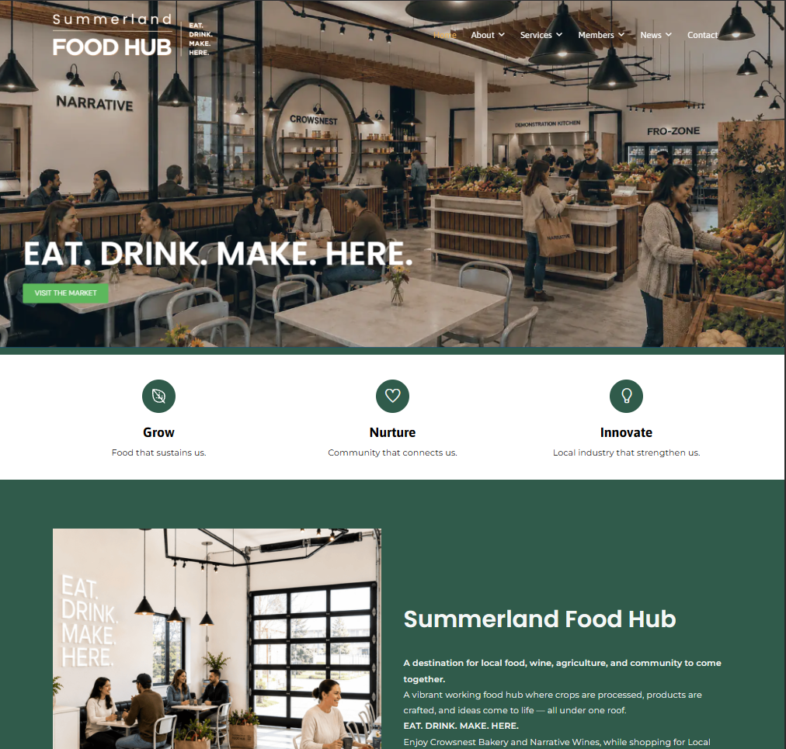
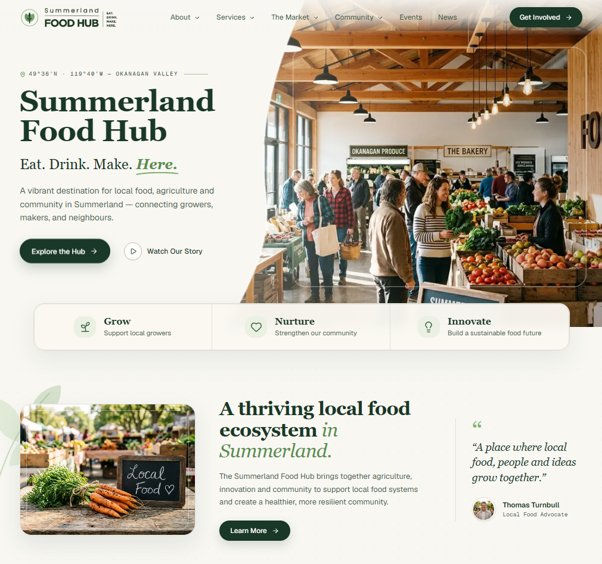

# 🌿 Summerland Food Hub — Website Redesign

A modern, editorial-style website for the **Summerland Food Hub** — a vibrant destination for local food, agriculture, and community in the Okanagan Valley. Built with Next.js 16, Tailwind CSS 4, and Motion (Framer Motion).

> **Original site:** [summerlandfoodhub.ca](https://summerlandfoodhub.ca/)
> This project is a complete front-end redesign, re-imagining the user experience with an organic, agricultural aesthetic and smooth motion design.

---

## ✨ Before & After

<table>
  <tr>
    <th>Old Website</th>
    <th>Redesigned Website</th>
  </tr>
  <tr>
    <td></td>
    <td></td>
  </tr>
</table>

---

## 🚀 Tech Stack

| Layer | Technology |
|---|---|
| **Framework** | [Next.js 16.4.6](https://nextjs.org/) (App Router, Turbopack) |
| **Language** | TypeScript 5 |
| **Styling** | [Tailwind CSS 4.3](https://tailwindcss.com/) |
| **Animations** | [Motion](https://motion.dev/) (Framer Motion), custom `Reveal`, `BlurText`, `CircularText`, `Magnet` primitives |
| **UI Components** | [shadcn/ui](https://ui.shadcn.com/), `SpotlightCard`, custom botanical design system |
| **Icons** | [Pulso Icons](https://pulsoicons.com/) (`pulsoicon-react`) — animated icon set |
| **React** | React 19.3 |

---

## 📁 Project Structure

```
summerland-food-hub/
├── app/                          # Next.js App Router pages
│   ├── page.tsx                  # Home
│   ├── about/
│   │   ├── page.tsx              # About Overview — mission & impact
│   │   ├── farmers/page.tsx      # LocalMotive Farmers Cooperative
│   │   ├── team/page.tsx         # Meet The Team
│   │   ├── okanagan-food-innovation-hub/page.tsx  # OFIC page
│   │   └── partners/page.tsx     # Our Partners
│   ├── events/
│   │   ├── page.tsx              # Events listing
│   │   └── [slug]/page.tsx       # Event detail (dynamic)
│   ├── news/
│   │   ├── page.tsx              # News listing
│   │   └── [slug]/page.tsx       # Article detail (dynamic)
│   ├── contact/page.tsx          # Contact
│   └── membership/page.tsx       # Membership
│
├── components/
│   ├── about/                    # About section pages
│   │   ├── AboutPage.tsx         # Mission, impact metrics, ecosystem
│   │   ├── FarmersPage.tsx       # Farmers cooperative & CSA
│   │   ├── TeamPage.tsx          # Team photo grid
│   │   └── OkanaganInnovationPage.tsx  # OFIC processing zones
│   ├── home/                     # Home page & shared motion primitives
│   │   ├── HomePage.tsx          # Hero, pillars, ecosystem
│   │   ├── MotionPrimitives.tsx  # Reveal, AnimatedStatNumber, easing
│   │   └── BrandMarks.tsx        # SVG brand emblems
│   ├── events/                   # Event components
│   │   ├── EventsPage.tsx        # Events listing with filters
│   │   ├── EventDetailsPage.tsx  # Single event view
│   │   └── eventLoader.ts       # Shared event data loader
│   ├── news/                     # News components
│   │   ├── NewsPage.tsx          # News grid with search & categories
│   │   └── ArticleDetailsPage.tsx # Single article view
│   ├── contact/ContactPage.tsx   # Contact form
│   ├── membership/MembershipPage.tsx  # Membership information
│   ├── layout/                   # Layout components
│   │   ├── Header.tsx            # Nav with dropdowns, active highlighting
│   │   ├── Footer.tsx
│   │   └── navData.ts            # Navigation structure
│   ├── BlurText.tsx              # Animated blur-reveal text
│   ├── CircularText.tsx          # Rotating circular badge
│   ├── Magnet.tsx                # Magnetic hover effect
│   └── SpotlightCard.tsx         # Spotlight hover card
│
├── lib/
│   ├── events.ts                 # Event data
│   ├── news.ts                   # News/article data
│   └── utils.ts                  # Utility helpers
│
└── public/
    ├── images/                   # Local images
    └── transition/               # Before/after comparison screenshots
        ├── old.png               # Original summerlandfoodhub.ca
        └── new.png               # This redesign
```

---

## 🎨 Design System

The site uses a custom organic/agricultural aesthetic:

| Token | Value | Usage |
|---|---|---|
| **Cream** | `#F8F7F2` | Page backgrounds |
| **Evergreen** | `#193827` | Primary text, dark sections, buttons |
| **Sage** | `#5A8E50` | Accents, icons, active states |
| **Lime** | `#A3C962` | CTA highlights on dark backgrounds |
| **Paper** | `bg-cream-paper` | Content sections with subtle texture |

**Typography:** Serif headings (editorial feel) with sans-serif body text.

**Motion primitives:**
- `Reveal` — scroll-triggered fade + slide
- `BlurText` — word-by-word blur-to-focus headline animation
- `CircularText` — rotating circular badge with hover interaction
- `Magnet` — magnetic cursor-following hover effect
- `SpotlightCard` — spotlight that follows the cursor over cards
- `BotanicalLeafWatermark` — decorative SVG leaf overlays

---

## 📄 Pages

| Route | Description |
|---|---|
| `/` | Hero, 3-pillar bar (Grow/Nurture/Innovate), ecosystem overview, impact metrics |
| `/about` | Mission & food security narrative, 35% impact stats, three pillars, upcoming market |
| `/about/farmers` | LocalMotive Farmers Cooperative, producer profiles, CSA box info |
| `/about/team` | Team photo grid (14 members) |
| `/about/okanagan-food-innovation-hub` | OFIC pillars, processing zones (Commercial Kitchen, Wet/Cold Processing, Retail, Packaging), facility CTA |
| `/about/partners` | Partner organizations |
| `/events` | Filterable events listing |
| `/events/[slug]` | Event detail with date, location, registration |
| `/news` | Searchable news grid with category filtering |
| `/news/[slug]` | Full article view |
| `/contact` | Contact form with topic selection |
| `/membership` | Membership tiers and benefits |

---

## 🛠️ Getting Started

### Prerequisites

- **Node.js** 18.17+ (recommended: 20+)
- **npm** (comes with Node.js)

### Installation

```bash
# Clone the repository
git clone <repository-url>
cd summerland-food-hub

# Install dependencies
npm install
```

### Development

```bash
npm run dev
```

Open [http://localhost:3000](http://localhost:3000) in your browser. The app uses **Turbopack** for fast hot-reload.

### Build

```bash
npm run build
npm run start
```

### Lint & Type Check

```bash
# TypeScript
npx tsc --noEmit

# ESLint
npm run lint
```

---

## 📦 Key Dependencies

| Package | Purpose |
|---|---|
| `next` 16.4.6 | Full-stack React framework (App Router) |
| `react` 19.3 | UI library |
| `tailwindcss` 4.3.3 | Utility-first CSS |
| `motion` 12.x | Animation library (Framer Motion) |
| `pulsoicon-react` | Animated icon set (drop-in Lucide replacement) |
| `shadcn` | UI component primitives |
| `class-variance-authority` | Variant-based component styling |
| `tw-animate-css` | Tailwind CSS animation utilities |

---

## 🌐 Original Website

This project is a redesign of the existing Summerland Food Hub WordPress site:

**🔗 [summerlandfoodhub.ca](https://summerlandfoodhub.ca/)**

The original site is built with WordPress + Elementor. This redesign rebuilds the entire front-end using modern web technologies while preserving all content and improving the visual design, navigation, page speed, and user experience.

### What Changed

- **Framework:** WordPress/Elementor → Next.js 16 (App Router, SSG)
- **Design language:** Standard template → custom organic/editorial aesthetic
- **Navigation:** Flat menu → structured dropdowns with active section highlighting
- **Animations:** None → scroll-triggered reveals, blur-text effects, magnetic interactions
- **Performance:** Heavy page-builder → static generation with optimized images
- **Information Architecture:** Reorganized pages under clear About/Services/Community sections

---

## 📝 License

Private project — not open source.
